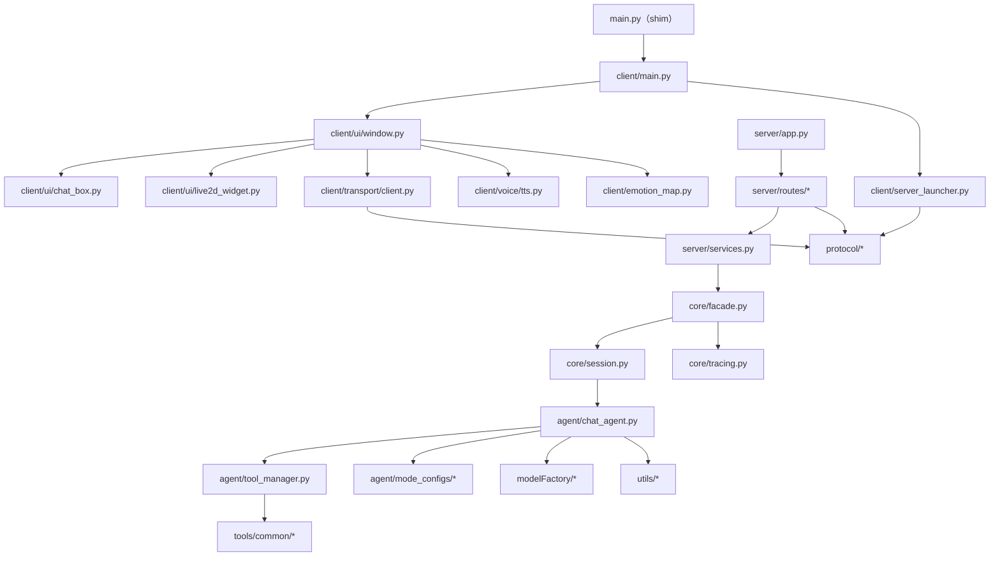

# 前后端 HTTP/SSE 解耦执行文档

> 版本：v1（调研稿，待确认）
> 日期：2026-11-09
> 状态：**仅调研，未改动任何业务代码**
> 对应提示词：`提示词_前后端HTTP解耦改造.md`

---

## 0. 结论摘要

本次改造把当前"PySide 单体应用"拆为三层：

```
client（PySide6 + live2d-py + TTS）
        │  HTTP + SSE（127.0.0.1）
        ▼
server（FastAPI + uvicorn，无 GUI）
        │  同步函数调用
        ▼
core（纯 Python 门面 / 会话 / 指标） + agent / modelFactory / tools / utils
```

关键结论：

1. **Agent 语义不改**：保留 `ChatAgent.chat()` 的手写工具循环、`MAX_TOOL_STEPS`、`parse_reply_json`、`set_mode`。
2. **只切三个耦合点**：`chat_with_model(..., live2d_model=)`、`agent/expression_driver.drive_expression`、`chatbotTTS.speak()` 的调用位置。
3. **server 内 Agent 仍同步执行**：`await asyncio.to_thread(agent.chat, ...)`；不在 core 引入 async。
4. **事件循环选型：QThread + `httpx.Client.stream()` + `httpx_sse`**。qasync 需要新增依赖且与 `QOpenGLWidget` 120fps 定时器存在未知风险，本期不引入；`Transport` 接口保留未来替换能力。
5. **现有测试零断言改动**：186 passed 作为基线；只允许改 import 路径，以及 P1 删除 `live2d_model` 形参后同步删除 6 处调用实参（不含任何断言）。若要求测试文件"一个字都不改"，P1 退化为保留被忽略的兼容形参。
6. **新增依赖仅限**：`fastapi`、`uvicorn`、`httpx`（显式声明）、`httpx-sse`（显式声明，当前为传递依赖）。

章节对应（提示词要求 → 本文）：现状架构 §2、耦合点清单 §3、目标架构 §4、迁移表 §5、通信协议 §6、事件循环 §7、分阶段 §8、风险 §9、Out of Scope §10、测试计划 §11；§1 为调研基线，§12–§13 为验收与待确认项。

---

## 1. 基线记录

### 1.1 测试基线

执行：

```
.venv\Scripts\python.exe -m pytest -q
```

结果：

```
186 passed in 16.05s
```

无失败、无 warning 输出。各文件用例数：

| 测试文件 | 用例数 |
|---|---:|
| `tests/test_chat_agent.py` | 38 |
| `tests/test_chatbot.py` | 15 |
| `tests/test_config_handler.py` | 5 |
| `tests/test_expression_driver.py` | 16 |
| `tests/test_factory.py` | 9 |
| `tests/test_get_time.py` | 10 |
| `tests/test_logger_handler.py` | 6 |
| `tests/test_mode_configs.py` | 15 |
| `tests/test_path_tool.py` | 7 |
| `tests/test_prompt_loader.py` | 4 |
| `tests/test_tool_manager.py` | 10 |
| `tests/test_tts.py` | 21 |
| `tests/test_weather.py` | 17 |
| `tests/test_web_search.py` | 13 |
| **合计** | **186** |

### 1.2 环境基线

| 项 | 现状 | 影响 |
|---|---|---|
| Python | 3.13（`requires-python >=3.13`） | 保持 |
| 依赖管理 | `pyproject.toml` + `uv.lock` | P2 用 `uv add` 增加依赖 |
| `fastapi` | **未安装** | P2 必须安装 |
| `uvicorn` | **未安装** | P2 必须安装 |
| `httpx` | 已安装（langchain 传递依赖） | 需在 `pyproject.toml` 显式声明 |
| `httpx_sse` | 已安装（传递依赖） | 需显式声明 |
| `pydantic` | 已安装 | 可直接用于 `protocol/` |
| `qasync` | **未安装** | 本期不引入（属新增框架依赖，需另行确认） |
| `.env` 键名 | `API_KEY`、`BASE_URL`、`MODEL`、`TTS_MODE`、`EDGE_TTS_VOICE`、`DASHSCOPE_API_KEY`、`DASHSCOPE_MODEL`、`DASHSCOPE_VOICE` | 不读值、不输出密钥 |
| Git 基线 | 工作区仅 `提示词_前后端HTTP解耦改造.md` 未跟踪；最近提交 `09320b0` | P1 开工前先提交/忽略该提示词，保证干净 |

> 注：`logs/`、`chat_history/` 已被 `.gitignore` 忽略；`main.py` 仍被 `tests/test_path_tool.py::test_contains_main_py` 断言必须存在，因此根目录 `main.py` 只能改成 shim，不能删除。

---

## 2. 现状架构

### 2.1 模块依赖图

```mermaid
graph TD
    subgraph UI["UI 进程（当前就是主进程）"]
        MAIN["main.py"]
        UI["chatbotUI.py<br/>AIWorker / ChatBox / Live2DWidget / ImageWindow"]
        TTS["chatbotTTS.py<br/>_StreamPlayer / speak / stop"]
    end

    subgraph Facade["门面"]
        CB["chatbot.py<br/>_agent / last_partial_reply<br/>chat_with_model / switch_mode"]
    end

    subgraph Core["纯逻辑"]
        AG["agent/chat_agent.py<br/>ChatAgent / HistoryStore / parse_reply_json"]
        TM["agent/tool_manager.py"]
        EX["agent/expression_driver.py<br/>VALID_EMOTIONS / EMOTION_MOTION_MAP"]
        MC["agent/mode_configs/*"]
        MF["modelFactory/factory.py"]
        TL["tools/common/*"]
        UT["utils/*"]
        PR["prompts/* + config/*"]
    end

    MAIN --> UI
    MAIN --> CB
    UI -->|"直接调用"| CB
    UI -->|"直接调用"| TTS
    UI -->|"live2d_model=self.live2d_widget"| CB
    CB --> AG
    AG -->|"drive_expression(emotion, live2d_widget)"| EX
    AG --> TM
    AG --> MC
    AG --> MF
    AG --> UT
    TM --> TL
    TL --> UT
    UT --> PR
```

**问题本质**：UI、门面、agent、live2d 在同一个进程、同一个模块全局状态里，调用链上直接传 `Live2DWidget` 对象，导致 agent 无法脱离 GUI 运行。

### 2.2 启动时序（现状）

`main.py:23-58`：

1. `QSurfaceFormat` 设置 alpha / 4x MSAA（`main.py:26-29`），必须在 `QApplication` 之前。
2. 校验 `chatbotUI.MODEL_PATH`（`main.py:32-35`）。
3. `chatbot.init_api_key_from_env()`（`main.py:39`）→ 初始化全局 `_agent`。
4. `live2d.init()`（`main.py:45`）。
5. `QApplication`（`main.py:47`）→ `chatbotUI.ImageWindow()`（`main.py:51`）→ `app.exec()`（`main.py:56`）。
6. 退出后 `live2d.dispose()`（`main.py:58`）。

**耦合后果**：API Key 初始化失败就 `sys.exit(1)`（`main.py:40-42`），桌宠无法显示；改造后"后端未就绪"必须降级为 UI 提示而不是退出。

### 2.3 一轮对话的现状调用链

```
ChatBox.submit
  → ImageWindow.on_input_submitted           chatbotUI.py:602
  → new AIWorker(user_input, live2d_model=live2d_widget)   chatbotUI.py:610
  → AIWorker.run (QThread)                   chatbotUI.py:60
  → chatbot.chat_with_model(user_input, live2d_model=...)  chatbotUI.py:63
  → _agent.chat(user_input, live2d_model=...)              chatbot.py:83
  → ChatAgent.chat                           agent/chat_agent.py:188
      → llm_with_tools.invoke(...)           agent/chat_agent.py:207
      → tool.invoke(args)                    agent/chat_agent.py:229
      → parse_reply_json(...)                agent/chat_agent.py:244
      → drive_expression(emotion, live2d_widget)  agent/chat_agent.py:246
          → live2d_widget.request_play_motion.emit(group)  agent/expression_driver.py:69
  → response_ready.emit(reply)               chatbotUI.py:64
  → ImageWindow.on_ai_response               chatbotUI.py:614
      → ChatBox.finalize_ai_reply            chatbotUI.py:616
      → chatbotTTS.speak(response)           chatbotUI.py:619
```

---

## 3. 关键耦合点清单（文件 + 函数 + 行级）

| # | 位置 | 代码/行为 | 为什么是耦合 | 处理方式 |
|---|---|---|---|---|
| C1 | `chatbot.py:71` | `def chat_with_model(user_input: str, live2d_model=None) -> str` | 门面把 UI 对象作为参数暴露给 agent 调用链 | P1 从 core/facade 删除该形参；根 `chatbot.py` 过渡期接受并忽略 |
| C2 | `chatbot.py:83` | `_agent.chat(user_input, live2d_model=live2d_model)` | 门面把 UI 对象继续下传 | P1 改为 `_agent.chat(user_input)` |
| C3 | `chatbot.py:21` | 模块全局 `_agent: ChatAgent \| None` | 单例全局，无法多会话、无法在 server 内隔离测试 | P1 迁移到 `core/facade.py`；P2 由 `core/session.py` 管理 |
| C4 | `chatbot.py:24` | 全局 `last_partial_reply` | UI 线程通过 `getattr(chatbot, ...)` 读取半成品（`chatbotUI.py:69`） | P1 保留兼容；P3 由错误事件 `error` 承载 |
| C5 | `agent/chat_agent.py:188` | `def chat(self, user_input: str, live2d_model=None)` | core 层签名直接依赖 UI 类型 | P1 删除形参，改为返回 `TurnResult` |
| C6 | `agent/chat_agent.py:30` | `from agent.expression_driver import drive_expression` | agent 依赖"表情驱动"这一表现层行为 | P1 删除 import；core 只做情感合法性校验 |
| C7 | `agent/chat_agent.py:245-246` | 注释 + `drive_expression(emotion, live2d_widget=live2d_model)` | agent 内部直接操作 UI（经信号） | P1 删除；由 client 收到 `emotion` 事件后播放 |
| C8 | `agent/expression_driver.py:35-42` | `EMOTION_MOTION_MAP`（情感 → hiyori 动作组） | 表现层资源语义（动作组名）放在 core | P1 迁移到 `client/emotion_map.py` |
| C9 | `agent/expression_driver.py:45-71` | `drive_expression(emotion, live2d_widget)` + `request_play_motion.emit` | core 依赖 Live2DWidget 的信号 | P1 迁移到 client；core 只保留 `VALID_EMOTIONS` |
| C10 | `chatbotUI.py:30-31` | `import chatbot` / `import chatbotTTS` | UI 直接依赖门面与语音模块 | P3 改为 `transport` + `client.voice.tts` |
| C11 | `chatbotUI.py:55-63` | `AIWorker.__init__(..., live2d_model)` / `run()` 调用门面 | UI 线程直接调 agent 门面 | P3 改为 `Transport.send()` + SSE 回调 |
| C12 | `chatbotUI.py:69` | `getattr(chatbot, 'last_partial_reply', '')` | UI 读取门面全局状态 | P3 删除，错误走 `error` 事件 |
| C13 | `chatbotUI.py:610` | `AIWorker(user_input, live2d_model=self.live2d_widget)` | UI 把 Live2DWidget 传进后台线程 | P3 删除；emotion → `request_play_motion` |
| C14 | `chatbotUI.py:619` | `chatbotTTS.speak(response)` | 语音调用绑定在窗口回复回调 | P3 由 `client/voice/tts.py` 承担，仍在主线程调用 |
| C15 | `chatbotUI.py:218/242` | `request_play_motion = Signal(str)` / `connect(_do_play_emotion_motion)` | 现有跨线程安全机制 | 保留，作为 client 内部唯一 live2d 入口 |
| C16 | `chatbotUI.py:261` | `self.startTimer(int(1000 / 120))` | 120fps 渲染定时器绑定 Qt 主线程 | 保留；qasync 方案的主要风险点 |
| C17 | `chatbotUI.py:350-369` | `timerEvent` 中 `Update/Draw/StartMotion` | live2d 只能在 Qt 主线程操作 | 保留；后台只能 emit 信号 |
| C18 | `chatbotTTS.py:31-32` | `_MODULE_DIR` / `_ENV_PATH` 基于本文件目录 | 文件移动后 `.env` 解析会失效 | P3 改为 `utils.path_tool.get_abs_path(".env")` |
| C19 | `chatbotTTS.py:199-202` | 全局 `_player` / `_session_counter` | 单例播放器，进程内唯一 | 保持；P3 仅移动文件 |
| C20 | `agent/chat_agent.py:40-41` | `HISTORY_DIR` / `HISTORY_FILE = default.json` | 固定单会话文件，多会话会互相污染 | P1/P2 给 `ChatAgent` 增加可选 `history_file`，默认值不变 |
| C21 | `agent/chat_agent.py:51` | `HistoryStore()` 无参构造 | 无法注入会话文件 | P1 改为 `HistoryStore(file_path=self.history_file)` |
| C22 | `chatbotUI.py:35-38` | `MODEL_PATH` 基于 `chatbotUI.py` 所在目录 | 拆分到 `client/ui/` 后路径会变 | P3 改用 `utils.path_tool.get_abs_path("Resources/...")` |
| C23 | `main.py:18-19` | `import chatbot` / `import chatbotUI` | 入口同时拉起 UI 与 agent | P3 根 `main.py` 改为 `from client.main import main` shim |
| C24 | `tests/test_chatbot.py:87/117` | `patch("chatbot.ChatModelFactory")` | 补丁目标依赖模块名 | 用 `sys.modules[__name__] = core.facade` 的 shim 保持同名模块对象 |
| C25 | `tests/test_expression_driver.py:7-11` | 从 `agent.expression_driver` 同时导入映射与驱动 | 迁移后 core 不再有映射 | 改 import 路径（断言不变）：`VALID_EMOTIONS` 来自 agent；映射与 `drive_expression` 来自 client |
| C26 | `tests/test_tts.py:13` | `import chatbotTTS` / `chatbotTTS.stop()` | 模块移动后 import 失效 | 改为 `from client.voice import tts as chatbotTTS`（断言不变） |
| C27 | `tests/test_chat_agent.py:354/371/388/403/414` | `agent.chat(..., live2d_model=None)` | P1 删除形参后调用会 TypeError | 同步删除 6 处实参（断言不变）；或保留兼容形参（见 9.2） |

### 3.1 依赖方向现状（用 grep 验证）

当前违反目标依赖方向的 import：

| 文件 | 违规 import | 目标 |
|---|---|---|
| `chatbotUI.py:18-28` | `live2d.v3`、`PySide6.*`、`OpenGL.GL`、`numpy` | 全部迁入 `client/` |
| `main.py:14-16` | `live2d.v3`、`PySide6.*` | 迁入 `client/main.py` |
| `expression_tester.py:15-25` | `live2d.v3`、`PySide6.*`、`OpenGL.GL`、`numpy` | 保持根目录独立运行，不属于 core |
| `agent/chat_agent.py:17` | `langchain_core.messages` | 允许（agent 属 core 侧） |
| `agent/tool_manager.py:7`、`tools/common/*.py` | `langchain_core` / `langchain_core.tools` | 允许 |
| `modelFactory/factory.py:5` | `langchain_openai` | 允许 |

目标规则：

- `core/`、`agent/`、`tools/`、`utils/`、`modelFactory/` **禁止**出现 `PySide6`、`live2d`、`httpx`、`fastapi`。
- `client/` **禁止**出现 `langchain`、`langchain_openai`、`openai`、`langgraph`。
- `server/` 可以 import `core` 与 `protocol`，**禁止** import `client`。
- `protocol/` 只依赖 `pydantic`，不依赖三层中的任何一层。

---

## 4. 目标架构

### 4.1 分层职责

| 层 | 职责 | 明确不做 |
|---|---|---|
| `core/` | 初始化、会话管理、每轮对话入口、指标采集 | 不碰 Qt、不碰 live2d、不发 HTTP |
| `agent/` | 模型调用、工具循环、历史持久化、JSON 解析、模式配置 | 不碰 UI、不碰表情动作组 |
| `server/` | HTTP 路由、SSE 编码、token 校验、阻塞调用线程化 | 不含业务语义、不 import client |
| `protocol/` | 请求体 / SSE 事件 pydantic 模型 | 不写业务逻辑 |
| `client/` | 窗口、聊天框、Live2D 渲染、TTS、传输、拉起 server | 不 import langchain / openai |
| `main.py` | 兼容入口 shim | 不含逻辑 |
| `expression_tester.py` | 独立调试台 | 不接入 server |

### 4.2 目标依赖图



### 4.3 `TurnResult` 定义（core 对 server 的唯一输出）

为避免 `tests/test_chat_agent.py` 的 `result["emotion"]` / `result["reply"]` 断言失效，`TurnResult` 使用 `TypedDict`（运行时仍是 `dict`）：

```python
class ToolCallRecord(TypedDict):
    name: str
    args: dict
    ok: bool
    duration_ms: int

class TurnResult(TypedDict):
    reply: str
    emotion: str          # 已通过 VALID_EMOTIONS 校验
    mode: str             # emotion / office
    tool_calls: list[ToolCallRecord]
    steps: int            # 实际模型调用轮数
    latency_ms: int       # core 内单轮耗时
```

放置位置：`agent/chat_agent.py`（生产者一侧）；`core/session.py` 与 `core/facade.py` 只做 re-export。这样保持 `core → agent` 的单向依赖，**禁止 `agent/` 反向 import `core/`**。

> 备选：若你希望 `TurnResult` 是 dataclass，则必须改 14 个测试中 5 处下标访问；不推荐。

---

## 5. 目录与文件迁移表

| 现有文件/目录 | 目标 | 动作 | 理由 |
|---|---|---|---|
| `main.py` | `main.py` | **保留为 shim** | `test_path_tool.py` 要求存在；一键启动入口不变 |
| `main.py` 的逻辑 | `client/main.py` | 拆分 | OpenGL 格式、`live2d.init`、窗口创建属于 client |
| `chatbot.py` | `core/facade.py` | 演化 | 初始化 + 每轮入口；去掉 UI 参数 |
| `chatbot.py` | `chatbot.py` | **保留为兼容 shim** | `tests/test_chatbot.py` 的 `import chatbot` / patch 目标不变 |
| `chatbotUI.py::AIWorker` | `client/transport/client.py` | 拆分 + 重写 | 从"直接调门面"改为"消费 SSE" |
| `chatbotUI.py::ChatBox` | `client/ui/chat_box.py` | 拆分 | 纯 UI，逻辑不变 |
| `chatbotUI.py::Live2DWidget` | `client/ui/live2d_widget.py` | 拆分 | 路径改为 `get_abs_path`；保留 `request_play_motion` |
| `chatbotUI.py::ImageWindow` | `client/ui/window.py` | 拆分 | 改为组装 transport / TTS / 聊天框 |
| `chatbotUI.py:35-38 MODEL_PATH` | `utils/path_tool.get_abs_path(...)` | 重算 | 拆分后相对路径失效 |
| `chatbotTTS.py` | `client/voice/tts.py` | 迁移 | 逻辑不变，只改 `.env` 定位与 import |
| `agent/expression_driver.py` | `agent/expression_driver.py` + `client/emotion_map.py` | 拆分 | core 保留 `VALID_EMOTIONS` 校验；映射与播放迁 client |
| `agent/chat_agent.py` | 原位 | 修改 | 去掉 live2d；返回 `TurnResult`；记录 tool_calls |
| `agent/tool_manager.py` | 原位 | 不动 | 纯逻辑 |
| `agent/mode_configs/*` | 原位 | 不动 | 纯配置 |
| `modelFactory/factory.py` | 原位 | 不动 | 纯逻辑 |
| `tools/common/*` | 原位 | 不动 | 纯工具 |
| `utils/*` | 原位 | 不动 | 纯工具 |
| `prompts/*`、`config/*` | 原位 | 不动 | 数据 |
| `resources.py` | 原位 | 不动 | 资源路径 + package sys.path |
| `expression_tester.py` | 原位 | 不动 | 硬性约束：必须继续独立运行 |
| `tests/*`（14 个） | 原位 | 仅改 import（+ P1 的 6 处实参） | 断言零改动 |
| `chat_history/default.json` | 原位 | 不动 | 老对话记录不丢 |
| `logs/turns.jsonl` | 新增 | 新增 | 每轮指标 |
| `core/facade.py` | 新增 | 新增 | 初始化 / 对话入口 |
| `core/session.py` | 新增 | 新增 | `session_id → ChatAgent` + per-session 锁 |
| `core/tracing.py` | 新增 | 新增 | `logs/turns.jsonl` |
| `protocol/requests.py` | 新增 | 新增 | 请求体模型 |
| `protocol/events.py` | 新增 | 新增 | SSE 事件模型 |
| `server/app.py` | 新增 | 新增 | `create_app()` 工厂 |
| `server/routes/chat.py` | 新增 | 新增 | `/v1/chat`、`/v1/interrupt` |
| `server/routes/meta.py` | 新增 | 新增 | `/v1/health`、`/v1/modes`、`/v1/mode` |
| `server/services.py` | 新增 | 新增 | 组装 core，DI 替换点 |
| `server/security.py` | 新增 | 新增 | `X-Hadali-Token` 校验 |
| `server/__main__.py` | 新增 | 新增 | uvicorn 启动，`--port 0` |
| `client/server_launcher.py` | 新增 | 新增 | 探活 / 拉起 / 端口 / token |
| `client/emotion_map.py` | 新增 | 新增 | 情感 → 动作组 + `drive_expression` |
| `client/transport/client.py` | 新增 | 新增 | `Transport` 接口 + QThread 实现 |
| `client/devtools/` | 新增 | 占位 | 后续调试工具挂载点 |
| `bench/run_bench.py` | 新增（P4） | 新增 | 20 条 prompt 批量评测 |
| `tests/test_protocol.py` | 新增（P2） | 新增 | 协议序列化 |
| `tests/test_session.py` | 新增（P2） | 新增 | 会话隔离 / 锁 / 路径安全 |
| `tests/test_tracing.py` | 新增（P2） | 新增 | JSONL 字段 / 截断 |
| `tests/test_server_api.py` | 新增（P2） | 新增 | ASGITransport + 假 agent |
| `tests/test_transport.py` | 新增（P3） | 新增 | SSE 解析 / 断连 / 错误 |

> `client/devtools/` 只建目录占位；`expression_tester.py` 本体**不移动**。

---

## 6. 通信协议 v1

### 6.1 接口表

| 方法 | 路径 | 请求体 | 响应 | 说明 |
|---|---|---|---|---|
| POST | `/v1/chat` | `{"session_id": "...", "text": "...", "mode": "emotion"\|null}` | `text/event-stream` | 一轮对话 |
| POST | `/v1/interrupt` | `{"session_id": "..."}` | `{"ok": true}` | 客户端打断当前轮（尽力而为） |
| GET | `/v1/health` | 无 | `{"status":"ok","version":"...","model":"..."}` | 探活 |
| GET | `/v1/modes` | 无 | `{"current":"emotion","modes":[{"name":"...","display_name":"..."}]}` | 模式列表 |
| POST | `/v1/mode` | `{"mode":"office"}` | `{"ok":true,"current":"office"}` | 切换进程级当前模式 |

补充约定：

- 所有请求/响应 `Content-Type: application/json`，除 `/v1/chat` 为 `text/event-stream`。
- 鉴权头：`X-Hadali-Token`。client 拉起 server 时用 `secrets.token_urlsafe(32)` 生成，经**环境变量** `HADALI_TOKEN` 传入（不放 argv，避免进程列表泄露）。
- server 未配置 `HADALI_TOKEN` 时放行（独立调试场景），并在日志中打一条 warning。
- 只监听 `127.0.0.1`，不对外暴露。
- `session_id` 允许字符 `^[A-Za-z0-9_-]{1,64}$`；不合法返回 400，防路径穿越。
- `mode` 在 `/v1/chat` 中为 `null` 时使用进程当前模式；非空时只影响该 session 的 agent。

### 6.2 SSE 事件表

每条事件都带公共字段：

| 字段 | 类型 | 说明 |
|---|---|---|
| `seq` | int | 本轮内从 1 递增 |
| `turn_id` | str | 一轮唯一 ID（uuid4 hex） |
| `ts` | int | Unix 毫秒时间戳 |

事件类型：

| event | 关键字段 | 触发时机 | 本期实现 |
|---|---|---|---|
| `turn.start` | `turn_id`, `mode` | 收到请求、会话锁获取后 | 立即发 |
| `state` | `value`: `thinking` / `speaking` / `idle` | 状态机变化 | 发 `thinking`、`speaking`、`idle` |
| `text.delta` | `text` | 文本增量 | 本期一次性下发整段 |
| `text.done` | `text` | 最终完整文本 | 本期与 `text.delta` 同内容 |
| `emotion` | `name`, `intensity?` | 情感标签就绪 | `name` 必须属于 `VALID_EMOTIONS` |
| `tool.call` | `name`, `args` | 工具调用开始 | 本期在 agent 完成后补发（见 6.5） |
| `tool.result` | `name`, `ok`, `duration_ms` | 工具调用结束 | 本期补发 |
| `turn.end` | `reply`, `emotion`, `latency_ms` | 本轮成功结束 | 最后一条 |
| `error` | `code`, `message`, `retryable` | 异常 | 替代 `turn.end` |
| `audio.start` / `audio.delta` / `audio.end` | 预留 | 未来 server 侧 TTS | **本期不发**，仅定义模型占位 |

状态机约定：

```
turn.start → state(thinking)
  ├─ 成功：state(speaking) → text.delta → text.done → emotion → tool.call/result* → turn.end → state(idle)
  └─ 失败：error → state(idle)
```

> 注意：`tool.call/result` 本期在 agent 返回后补发，事件顺序上位于 `text.*` 之后；P4 若增加回调，可前移到真实调用点。客户端不得依赖顺序做逻辑，只按 event 名处理。

### 6.3 两条完整示例报文

示例 A：正常一轮（整段文本 + 一次工具调用 + 表情）

```
POST /v1/chat HTTP/1.1
Host: 127.0.0.1:8765
X-Hadali-Token: <token>
Content-Type: application/json

{"session_id":"default","text":"北京今天天气怎么样","mode":null}
```

```
HTTP/1.1 200 OK
Content-Type: text/event-stream; charset=utf-8
Cache-Control: no-cache
X-Accel-Buffering: no

event: turn.start
data: {"seq":1,"turn_id":"9f2c1a7b4e8d4c0a","ts":1762646400000,"mode":"emotion"}

event: state
data: {"seq":2,"turn_id":"9f2c1a7b4e8d4c0a","ts":1762646400010,"value":"thinking"}

event: state
data: {"seq":3,"turn_id":"9f2c1a7b4e8d4c0a","ts":1762646402350,"value":"speaking"}

event: text.delta
data: {"seq":4,"turn_id":"9f2c1a7b4e8d4c0a","ts":1762646402351,"text":"北京现在晴，气温 18℃，体感 17℃，湿度 45%，北风 12km/h。记得早晚加件外套呀。"}

event: text.done
data: {"seq":5,"turn_id":"9f2c1a7b4e8d4c0a","ts":1762646402352,"text":"北京现在晴，气温 18℃，体感 17℃，湿度 45%，北风 12km/h。记得早晚加件外套呀。"}

event: emotion
data: {"seq":6,"turn_id":"9f2c1a7b4e8d4c0a","ts":1762646402353,"name":"relaxed"}

event: tool.call
data: {"seq":7,"turn_id":"9f2c1a7b4e8d4c0a","ts":1762646402354,"name":"get_weather","args":{"city":"北京"}}

event: tool.result
data: {"seq":8,"turn_id":"9f2c1a7b4e8d4c0a","ts":1762646402354,"name":"get_weather","ok":true,"duration_ms":820}

event: turn.end
data: {"seq":9,"turn_id":"9f2c1a7b4e8d4c0a","ts":1762646402355,"reply":"北京现在晴，气温 18℃，体感 17℃，湿度 45%，北风 12km/h。记得早晚加件外套呀。","emotion":"relaxed","latency_ms":2355}

event: state
data: {"seq":10,"turn_id":"9f2c1a7b4e8d4c0a","ts":1762646402356,"value":"idle"}
```

示例 B：模型/工具异常（可重试）

```
POST /v1/chat HTTP/1.1
Host: 127.0.0.1:8765
X-Hadali-Token: <token>
Content-Type: application/json

{"session_id":"default","text":"帮我查一下明天的安排","mode":"office"}
```

```
HTTP/1.1 200 OK
Content-Type: text/event-stream; charset=utf-8

event: turn.start
data: {"seq":1,"turn_id":"3b7e0d2a91f54c11","ts":1762646500000,"mode":"office"}

event: state
data: {"seq":2,"turn_id":"3b7e0d2a91f54c11","ts":1762646500010,"value":"thinking"}

event: error
data: {"seq":3,"turn_id":"3b7e0d2a91f54c11","ts":1762646505200,"code":"LLM_TIMEOUT","message":"大模型请求超时（30s），请稍后重试","retryable":true}

event: state
data: {"seq":4,"turn_id":"3b7e0d2a91f54c11","ts":1762646505201,"value":"idle"}
```

错误码约定：

| code | 含义 | retryable |
|---|---|---|
| `BAD_REQUEST` | 参数缺失/非法 | false |
| `UNAUTHORIZED` | token 不匹配 | false |
| `SESSION_BUSY` | 同 session 已有请求在跑（本期默认串行，超时排队） | true |
| `LLM_TIMEOUT` / `LLM_ERROR` | 模型异常 | true |
| `TOOL_ERROR` | 工具异常但已回填模型 | true |
| `INTERRUPTED` | 客户端主动打断 | true |
| `INTERNAL` | 未分类异常 | true |

### 6.4 协议实现约束

- `protocol/events.py` 用 pydantic 定义 `BaseEvent` + 各事件；server 用 `model_dump_json()` 序列化；client 用 `TypeAdapter` 按 event 名反序列化。
- **禁止两边各写一份 dict**：event 名用 `Enum` 常量，字段名只在一处定义。
- `text.delta` 本期整段下发，但字段命名、事件顺序为未来真流式预留：未来只需多次发 `text.delta`。
- `audio.*` 只定义模型，不实现发送；client 收到时忽略并记 debug 日志。

### 6.5 tool 事件的本期策略

`ChatAgent.chat()` 目前没有回调钩子。P2 采用"结束后补发"：

1. `TurnResult.tool_calls` 已包含 `name/args/ok/duration_ms`；
2. server 在 `text.done` 后依次补发 `tool.call` / `tool.result`；
3. 这样不修改 agent 主循环的控制流，符合"Agent 逻辑不重写"。

P4 可选增强：给 `ChatAgent.chat()` 增加可选 `on_tool_event: Callable[[str, dict], None]`，在 `tool.invoke` 前后真实回调。该增强需要你确认后才做。

---

## 7. 事件循环与线程方案

### 7.1 两方案对比

| 维度 | 方案 A：qasync | 方案 B：QThread + 同步 httpx |
|---|---|---|
| 主线程模型 | `QApplication` + `qasync.QEventLoop` 合一 | 保持 `QApplication.exec()` |
| 网络调用 | `httpx.AsyncClient` + `httpx_sse`，全程 await | `QThread.run()` 内 `httpx.Client.stream()` + `httpx_sse.connect_sse()` |
| Live2D 120fps（`chatbotUI.py:261`） | 与 asyncio 事件循环共享主线程，长任务可能拖慢帧率 | 完全不受影响 |
| `QOpenGLWidget` 上下文 | 需验证 `live2d.Update/Draw` 与事件循环共存 | 保持现状，风险为 0 |
| TTS 后台线程（`chatbotTTS.py`） | 与 asyncio 无冲突，但打断逻辑仍靠线程 | 保持现状 |
| 新增依赖 | `qasync`（**未安装，且不在允许新增清单**） | 无（`httpx` / `httpx_sse` 已在环境） |
| 调试难度 | 异步栈 + Qt 信号，异常传播复杂 | 与现有 `AIWorker` 模式一致 |
| 启动探活 | 必须异步，不能阻塞主线程 | 可在 QThread 或短超时同步做 |
| 回滚成本 | 需同时改 `app.exec()` 与 UI 生命周期 | 仅替换 `Transport` 实现 |

### 7.2 最终选型

**P3 基线采用方案 B：`QThread` + `httpx.Client.stream()` + `httpx_sse.connect_sse()`。**

理由：

1. **不新增框架依赖**。`qasync` 当前未安装，引入它需要你额外批准；提示词只允许 `fastapi / uvicorn / httpx`。
2. **保护 live2d 单线程**。现有 120fps `timerEvent → Update → Draw`（`chatbotUI.py:350-369`）已经在 Qt 主线程稳定运行，qasync 把 asyncio 循环塞进同一线程，收益不明确、风险明确。
3. **保持现有线程模型**。`AIWorker` 已经是 QThread（`chatbotUI.py:44-73`），把它替换为 `SseWorker(QThread)` 是最小改动。
4. **接口可替换**。`client/transport/client.py` 定义统一 `Transport`：

```python
class Transport(QObject):
    event_received = Signal(str, dict)   # (event_name, payload)
    failed = Signal(str)                 # 连接/协议错误

    def send(self, text: str, session_id: str = "default", mode: str | None = None) -> None: ...
    def interrupt(self, session_id: str = "default") -> None: ...
    def close(self) -> None: ...
```

未来若你批准 `qasync` 且 spike 通过，只新增 `AsyncTransport(Transport)`，UI 层不改。

### 7.3 qasync spike 预案（不阻塞本期）

若你希望保留 qasync 可能性，P3 开始前可做一次 30–60 分钟 spike：

- 环境：临时安装 `qasync`（不写入 `pyproject.toml`）。
- 验证：真实窗口 + `QEventLoop` + `Live2DWidget` 120fps + 连续 5 轮对话。
- 通过标准：无 GL 报错、无卡顿、打字机/TTS/表情正常。
- 若通过且你同意新增依赖，再切换方案 A；否则按方案 B 推进。

---

## 8. 分阶段任务清单

> 每阶段开始前：`git status` 必须干净（提示词文件先提交或加入忽略）。
> 每阶段结束：`pytest -q` 全绿 + 提交一次中文 commit。

### P1：core 去 UI 化（不动 server/client）

> 状态：已完成（2026-11-09），问题记录见 [http解耦开发记录.md](./http解耦开发记录.md)。

**改动文件**

| 文件 | 改动 |
|---|---|
| `agent/chat_agent.py` | `chat()` 删除 `live2d_model` 形参；删除 `drive_expression` import 与调用；记录 `tool_calls`、`steps`、`mode`、`latency_ms`；返回 `TurnResult`；新增可选 `history_file` 参数并传给 `HistoryStore`；对 `emotion` 用 `validate_emotion` 校验，非法回退 `neutral` |
| `agent/expression_driver.py` | 仅保留 `VALID_EMOTIONS` 与 `validate_emotion()`；删除 `EMOTION_MOTION_MAP` / `drive_expression`（迁 client） |
| `core/__init__.py` | 新增 |
| `core/session.py` | **推迟到 P2**（P1 无多会话调用方，避免无调用方的抽象） |
| `core/facade.py` | 由 `chatbot.py` 演化，但保持**无状态**：`load_env` / `create_agent(..., factory_cls)` / `create_agent_from_env` / `chat` / `switch_mode`；不持有 `_agent` 与 UI 状态 |
| `chatbot.py` | 改为**过渡适配器**：保留 `_agent` / `last_partial_reply` / `ChatModelFactory` 与 `chat_with_model(user_input, live2d_model=None)` 签名，委托 `core.facade`；传入 `live2d_model` 时懒加载 `client.emotion_map.drive_expression`（P3 移除该适配器） |
| `tests/test_chat_agent.py` | 删除 5 处 `live2d_model=None` 实参（断言不变） |
| `tests/test_expression_driver.py` | 改 import：`VALID_EMOTIONS` 来自 `agent.expression_driver`；`EMOTION_MOTION_MAP` / `drive_expression` 来自 `client.emotion_map`（断言不变） |
| `client/emotion_map.py` | 新增：`EMOTION_MOTION_MAP` + `drive_expression(emotion, live2d_widget)`（映射与 emit 逻辑照搬；未命中映射直接返回；不 import Qt，也不 import agent） |
| `client/__init__.py` | 新增 |

**验收**

1. `pytest -q` 186 passed。
2. `python -c "import chatbot; chatbot.init_api_key_from_env(); print(chatbot.chat_with_model('你好'))"` 能返回中文回复（需真实 Key；无 Key 时只验证到初始化异常）。
3. `python -c "from agent.chat_agent import ChatAgent"` 不触发任何 Qt / live2d import。
4. 全仓 grep：`core/ agent/ tools/ utils/ modelFactory/` 无 `PySide6|live2d|httpx|fastapi`。

**回滚**：`git revert <P1 commit>`；`chatbot.py` shim 保证旧入口可回退。

**风险**：~~`chatbot.py` 的 `sys.modules` 替换写法需要验证 pytest 收集阶段行为~~ 已处理：未采用 `sys.modules` 替换，改用过渡适配器（见开发记录 P1-2 / P1-4）。

### P2：server（FastAPI + SSE + DI + token）

> 状态：已完成（2026-11-09），问题记录见 [http解耦开发记录.md](./http解耦开发记录.md)。
> 实现补充：参数校验错误统一由 `RequestValidationError` 处理器映射为 400（FastAPI 默认 422）；`/v1/interrupt` 仅返回确认（同步 agent 无法安全强杀工作线程）。

**前置**：`uv add fastapi uvicorn httpx httpx-sse`，并在 `pyproject.toml` 显式列出现有依赖 `httpx`、`httpx-sse`。

**改动文件**

| 文件 | 内容 |
|---|---|
| `protocol/requests.py` | `ChatRequest` / `InterruptRequest` / `ModeRequest` |
| `protocol/events.py` | `EventName` 枚举；`BaseEvent`（`seq/turn_id/ts`）；各事件模型；`Audio*` 占位 |
| `core/session.py` | 完成 `SessionManager`：`session_id → ChatAgent`、per-session `asyncio.Lock`、`default.json` 兼容、session_id 正则校验 |
| `core/tracing.py` | `TurnTracer`：记录字段并追加 `logs/turns.jsonl` |
| `server/app.py` | `create_app(services: Services \| None = None)` |
| `server/services.py` | 初始化配置 / 模型工厂 / `SessionManager`；`get_services()` 依赖注入点 |
| `server/security.py` | `verify_token`（`secrets.compare_digest`；未配置 token 放行） |
| `server/routes/chat.py` | `/v1/chat` SSE 生成器；`/v1/interrupt` |
| `server/routes/meta.py` | `/v1/health`、`/v1/modes`、`/v1/mode` |
| `server/__main__.py` | `argparse`：`--host 127.0.0.1`、`--port 8765`；`--port 0` 时打印实际端口 |
| `tests/test_protocol.py`、`tests/test_session.py`、`tests/test_tracing.py`、`tests/test_server_api.py` | 新增 |

**`/v1/chat` 生成器伪代码**

```python
async def event_stream(req: ChatRequest):
    tracer = TurnTracer(...)
    seq = count(1)
    emit("turn.start", mode=...)
    emit("state", value="thinking")
    try:
        async with sessions.lock(req.session_id):
            result = await asyncio.to_thread(agent.chat, req.text)
        emit("state", value="speaking")
        emit("text.delta", text=result["reply"])
        emit("text.done", text=result["reply"])
        emit("emotion", name=result["emotion"])
        for tc in result["tool_calls"]:
            emit("tool.call", name=tc["name"], args=tc["args"])
            emit("tool.result", name=tc["name"], ok=tc["ok"], duration_ms=tc["duration_ms"])
        emit("turn.end", reply=..., emotion=..., latency_ms=...)
    except Exception as exc:
        emit("error", code=map_error(exc), message=str(exc), retryable=True)
    finally:
        emit("state", value="idle")
        tracer.write()
```

**验收**

1. `pytest tests/test_server_api.py -q`：用 `httpx.ASGITransport` + 假 agent，断言事件顺序与字段。
2. `curl -N -H "X-Hadali-Token: dev" -H "Content-Type: application/json" -d '{"session_id":"default","text":"你好","mode":null}' http://127.0.0.1:8765/v1/chat` 能看到完整事件流。
3. `python -m server --port 8765` 在无 GUI 环境启动；`GET /v1/health` 返回 `ok`。
4. 不配置 `HADALI_TOKEN` 时放行；配置错误 token 返回 401。

**回滚**：P2 只新增文件；`git revert` 后 client / main.py 完全不受影响。

### P3：client（transport + UI 拆分 + launcher + 打断）

**改动文件**

| 文件 | 内容 |
|---|---|
| `client/main.py` | 由 `main.py` 演化：OpenGL 格式、模型校验、`live2d.init()`、`QApplication`、`ServerLauncher`、`ImageWindow` |
| `main.py` | 改为 shim：`from client.main import main` |
| `client/ui/chat_box.py` | `ChatBox` 原样迁移；新增 `show_error(text)` 与 `to_input_state()` 复用 |
| `client/ui/live2d_widget.py` | `Live2DWidget` 迁移；`MODEL_PATH` 用 `get_abs_path`；保留 `request_play_motion` |
| `client/ui/window.py` | `ImageWindow`：持有 `Transport`、`TTS`、`Live2DWidget`、`ChatBox`；处理 SSE 事件 |
| `client/transport/client.py` | `Transport` 接口 + `SseWorker(QThread)` + `SseTransport(QObject)`；解析 SSE；错误信号 |
| `client/emotion_map.py` | 收到 `emotion` 事件 → `drive_expression(name, live2d_widget)` |
| `client/voice/tts.py` | `chatbotTTS.py` 迁移；`.env` 改为项目根定位；逻辑不变 |
| `client/server_launcher.py` | 探活 → 复用或 `subprocess.Popen([sys.executable, "-m", "server", ...])` |
| `client/devtools/__init__.py` | 占位 |
| `tests/test_tts.py` | import 改为 `from client.voice import tts as chatbotTTS`（断言不变） |
| `tests/test_transport.py` | 新增 |

**事件处理映射（client）**

| SSE event | UI 动作 |
|---|---|
| `turn.start` | `ChatBox.to_thinking_state()` |
| `state=thinking` | 保持思考态 |
| `state=speaking` | 准备显示（本期 `text.delta` 紧随其后） |
| `text.delta` | `ChatBox.finalize_ai_reply(text)` 启动打字机 |
| `text.done` | 若与 delta 相同则忽略；未来流式时用于收尾 |
| `emotion` | `drive_expression(name, self.live2d_widget)`（emit 信号 → 主线程播放） |
| `turn.end` | `chatbotTTS.speak(reply)`；`state=idle` 后允许点击恢复输入 |
| `error` | `ChatBox.show_error(message)`；不播报；不卡死；可重试 |
| `audio.*` | 本期忽略 |

**打断**

- 用户执行打断（快捷键/右键菜单/新一轮提交）时：
  1. `transport.interrupt(session_id)` → `POST /v1/interrupt`；
  2. `tts.stop()`（`chatbotTTS.py:410`，使 session 失效 + `_player.clear()`）；
  3. `Live2DWidget` 新增 `reset_emotion()`：清 `_return_transition`、`_emotion_motion_playing=False`、`_restore_auto_anim()`；
  4. `ChatBox.to_input_state()`。

**server_launcher 细节**

- 窗口先 `show()`，探活 / 拉起放在 `ServerLaunchWorker(QThread)` 中执行，**不阻塞主线程启动**。
- 默认地址 `http://127.0.0.1:8765`；支持 `--server-url` 与 `HADALI_SERVER_URL`。
- 探活超时 0.5s；首次失败则拉起子进程；健康检查轮询上限 5s。
- token：`secrets.token_urlsafe(32)`；通过环境变量 `HADALI_TOKEN` 传给子进程。
- `--port 0`：server 在 stdout 输出一行 `HADALI_SERVER_READY {"port":<N>}`；launcher 解析。
- Windows 下 `subprocess.CREATE_NO_WINDOW`，避免黑色控制台。
- 拉起失败：窗口仍显示，聊天框显示"后端未就绪，请检查日志"；不黑屏、不阻塞主线程。
- client 退出时终止自己拉起的子进程（`terminate()` + 等待，超时 `kill()`）。

**验收**：见第 12 节验收清单逐条。

**回滚**：P3 提交后若 live2d 异常，`git revert`；根 `main.py` shim 可临时改回旧实现（P1/P2 文件仍在）。

### P4：打磨与评测

| 文件 | 内容 |
|---|---|
| `bench/prompts.jsonl` | 20 条固定 prompt（闲聊 / 时间 / 天气 / 搜索 / 情绪） |
| `bench/run_bench.py` | 逐条打 SSE，记录首事件延迟、总延迟、工具调用、错误 |
| `bench/result.csv` | 输出 P50/P95、工具调用率、错误率 |
| `README.md` | 增加"前后端分离启动 / 独立后端 / 评测"章节 |
| `client/transport/client.py` | 重连一次 + 超时配置 |
| `server/routes/chat.py` | 错误码细化、`first_event_ms` 统计 |
| `tests/` | 补齐 transport 断连、server 错误码测试 |

**验收**：`python bench/run_bench.py` 生成 CSV；`pytest -q` 全绿；README 步骤可复现。

---

## 9. 风险清单

### 9.1 live2d 单线程

- **风险**：SSE 回调在 QThread 中直接调用 `Model.Update/Draw/StartMotion` → OpenGL 上下文错误、崩溃。
- **约束**：`request_play_motion.emit()` 是唯一跨线程入口；所有 `Model.*` 只在 `Live2DWidget` 主线程槽与 `timerEvent/paintGL` 中执行。
- **验证**：`grep -rn "StartMotion\|SetParamById\|model.Update\|model.Draw" client/`，除 `live2d_widget.py` 外不得出现。
- **兜底**：client 收到 `emotion` 时只 emit；若 widget 尚未初始化（`self.model is None`），直接丢弃。

### 9.2 SSE 断连 / 半包

- **风险**：server 被杀、网络中断、代理缓冲导致事件不完整。
- **措施**：`httpx` 读超时 60s；`httpx_sse` 负责分帧；捕获 `httpx.ReadError/RemoteProtocolError` → `failed` 信号 → UI 显示错误并回输入态。
- **兜底**：client 每轮只允许一个在途请求；断连后允许用户重发，不自动无限重试。
- **P4**：可选一次自动重连（仅连接失败，不重放已发送 turn）。

### 9.3 TTS 打断

- **风险**：新一轮回复到来时旧音频继续播放；或 `stop()` 后旧合成线程仍写入。
- **现状**：`_StreamPlayer.set_session()` + `enqueue(session)` 已能丢弃陈旧块（`chatbotTTS.py:98-134`）；`stop()` 会推进计数器（`chatbotTTS.py:410-413`）。
- **迁移要求**：`client/voice/tts.py` 逻辑逐行保留，只改 `.env` 定位；不得"顺手优化"。
- **验证**：现有 `tests/test_tts.py` 21 条全部通过；手工连续两轮播报确认旧音频立即停止。

### 9.4 会话与历史

- **风险**：多 session 同时写 `default.json`；历史串台；路径穿越。
- **措施**：
  - `SessionManager` 按 `session_id` 分配文件：`default` → `chat_history/default.json`；其他 → `chat_history/<safe_id>.json`；
  - `session_id` 只允许 `^[A-Za-z0-9_-]{1,64}$`；
  - 同一 session 用 `asyncio.Lock` 串行；不同 session 可并行；
  - `ChatAgent` 的 `HistoryStore` 由构造参数注入，不共享实例。
- **兜底**：历史文件损坏时沿用 `HistoryStore._load` 的容错（`agent/chat_agent.py:56-68`），重置为空并记 error。
- **注意**：server 进程与旧 client 同时写 `default.json` 仍可能冲突；P3 起只允许 client 通过 server 写历史。

### 9.5 测试 import 失效

- **风险**：文件移动后 `import chatbot`、`import chatbotTTS`、`agent.expression_driver` 的符号消失。
- **措施**：
  - `chatbot.py` 用 `sys.modules[__name__] = core.facade` 保持模块同名；
  - `tests/test_tts.py` 改 `from client.voice import tts as chatbotTTS`；
  - `tests/test_expression_driver.py` 拆分 import；
  - `tests/test_path_tool.py` 依赖的根 `main.py` 保留。
- **验证**：每阶段 `pytest -q`；`python -c "import chatbot, chatbotTTS"`（P3 后 `chatbotTTS` 可能不再存在，需同步更新测试）。
- **注意**：`sys.modules` 替换是过渡手段；P4 若你同意，可改为测试直接 import `core.facade` 并删除 shim。

### 9.6 双进程启动

- **风险**：端口占用、重复拉起 server、子进程变僵尸、`--port 0` 端口读取失败、Windows 控制台弹窗。
- **措施**：
  - 先探活再拉起；已存在则复用；
  - `--port 0` 由 stdout 的 `HADALI_SERVER_READY` 行回传；
  - `CREATE_NO_WINDOW`；
  - client `aboutToQuit` 时终止子进程；
  - 端口占用时 server 退出码非 0，launcher 提示"后端未就绪"。
- **兜底**：UI 不因后端失败而退出；桌宠照常显示。

### 9.7 错误兜底

- **风险**：模型异常、工具异常、JSON 解析失败、server 500、client 解析异常。
- **措施**：
  - core：`ChatAgent.chat` 保持现有 try/except + `history.save()`（`agent/chat_agent.py:250-253`）；
  - server：所有异常转 `error` 事件，`retryable` 按错误码；
  - client：`error` 事件 → 聊天框显示中文提示 → 回输入态；不调用 TTS；
  - `last_partial_reply` 仅 P1 兼容，P3 后不再依赖。
- **验证**：手工杀 server、断网、错误 token 三种场景各测一次。

### 9.8 其他风险

| 风险 | 说明 | 措施 |
|---|---|---|
| `.env` 路径失效 | `chatbotTTS.py:31-32` 依赖自身目录 | 迁移后统一 `get_abs_path(".env")` |
| `MODEL_PATH` 失效 | `chatbotUI.py:35-38` 依赖自身目录 | 迁移后 `get_abs_path("Resources/...")` |
| pydantic 版本冲突 | fastapi 可能要求更高 pydantic | 安装后跑全量测试；锁定兼容版本 |
| uvicorn 事件循环 | Windows 下默认 Proactor 事件循环 | 显式 `loop="asyncio"`，避免与 to_thread 的兼容问题 |
| token 泄漏 | 日志/异常栈打印请求头 | 日志不打印 `X-Hadali-Token`；异常信息脱敏 |
| SSE 缓冲 | 反向代理/浏览器缓冲 | `Cache-Control: no-cache`、`X-Accel-Buffering: no` |
| 长工具调用 | 单轮可能 > 60s | client 读超时 120s；server 不设短超时 |
| 历史并发 | 同 session 请求未串行 | per-session lock；锁等待超时返回 `SESSION_BUSY` |
| 进程孤儿 | client 崩溃未杀 server | server 增加父进程存活检测（P4） |
| 端口安全 | 绑定 0.0.0.0 会暴露 token 接口 | 强制默认 `127.0.0.1`；启动日志提示 |

---

## 10. 不做的事（Out of Scope）

本次明确**不做**：

1. 不换前端技术栈：继续 PySide6 + `live2d.v3`，不引入 Electron / Tauri / TypeScript / React / Vue。
2. 不重写 Agent：不引入 LangGraph / ReAct / `create_agent`；保留 `MAX_TOOL_STEPS=6`、手写工具循环、`parse_reply_json`、`set_mode` 语义。
3. 不在 core 引入 async：`ChatAgent.chat()` 保持同步；异步只在 server 请求处理与 client 传输层。
4. 不把 TTS 上移到 server：本期不通过 HTTP/SSE 传 PCM；只预留 `audio.*` 事件模型。
5. 不做真正的流式大模型输出：本期 `text.delta` 整段下发；事件结构支持未来升级。
6. 不做多用户/远程部署：只监听 `127.0.0.1`，token 仅本地防护。
7. 不做会话列表 UI、历史浏览、清空会话 UI。
8. 不做并发 turn：同一 session 串行，UI 单轮阻塞。
9. 不改提示词格式、JSON 输出约定、工具白名单机制。
10. 不顺手修既有 bug；发现后只记录在文档/issue。
11. 不重命名现有公共函数（除本方案明确要求的迁移）。
12. 不删除/放宽现有测试断言；`expression_tester.py` 逻辑不变。
13. 不改 `.env` 既有键语义；新增配置项必须有默认值且不配置也能跑。
14. 不提交/打印任何密钥。

---

## 11. 测试计划

### 11.1 保留的 14 个测试文件

| 文件 | 改动 |
|---|---|
| `tests/test_chatbot.py` | 零改动（依赖 `chatbot.py` 适配器保留的同名签名） |
| `tests/test_chat_agent.py` | 仅 5 处删除 `live2d_model=None` 实参 |
| `tests/test_expression_driver.py` | 仅拆 import 路径 |
| `tests/test_tts.py` | 仅改 import 为 `client.voice.tts` |
| 其余 10 个 | 零改动 |

### 11.2 新增测试

| 文件 | 覆盖点 | mock 策略 |
|---|---|---|
| `tests/test_protocol.py` | 请求体校验、事件必填字段、`model_dump_json` / 反序列化 roundtrip、`EventName` 唯一 | 无 |
| `tests/test_session.py` | `default` → `default.json`；自定义 session 文件；非法 id 拒绝；同 session 锁串行；不同 session 隔离 | 假 `ChatAgent` |
| `tests/test_tracing.py` | `turns.jsonl` 每行合法 JSON；字段齐全；用户原文不落全文（只留长度 + 截断摘要） | `tmp_path` |
| `tests/test_server_api.py` | `GET /v1/health`；`GET /v1/modes` 与 `POST /v1/mode`；`POST /v1/chat` 事件顺序；`error` 分支；token 401 / 无 token 放行；`/v1/interrupt` | `httpx.ASGITransport` + `create_app(services=FakeServices())` |
| `tests/test_transport.py` | SSE 帧解析；`text.delta` / `turn.end` / `error` 分发；连接失败 → `failed`；半包/断连不崩溃 | `httpx.MockTransport` / 本地 `http.server` |
| `tests/test_emotion_map.py`（可选） | 与现有 `test_expression_driver.py` 合并即可 | 无 |

### 11.3 大模型 mock

- **server 层**：`server/services.py` 定义 `Services` 协议；测试注入 `FakeServices`，其 `get_agent(session_id)` 返回 `FakeAgent.chat(text) -> TurnResult`。
- **core 层**：沿用 `_FakeFactory`（`tests/test_chat_agent.py:264-274`）模式，`MagicMock` 作为 LLM，`invoke` 返回 `AIMessage`。
- **禁止**：测试中真实请求 DeepSeek / DashScope / wttr.in / Bing。

### 11.4 SSE mock

- server 单测：直接调用路由函数或 `ASGITransport` 读取 `response.aiter_lines()`，按 `event:` / `data:` 组装。
- client 单测：用 `httpx.MockTransport` 返回预置 SSE 字节流；验证事件回调顺序与错误分支。
- 断连模拟：流中途抛 `httpx.ReadError`；断言发出 `failed` 且不抛未捕获异常。

### 11.5 手工验收脚本

```powershell
# 1. 无 GUI 启动后端
.venv\Scripts\python.exe -m server --port 8765

# 2. 健康检查
curl http://127.0.0.1:8765/v1/health

# 3. 事件流（另开终端）
curl -N -H "Content-Type: application/json" -d "{\"session_id\":\"default\",\"text\":\"你好\",\"mode\":null}" http://127.0.0.1:8765/v1/chat

# 4. 模式
curl http://127.0.0.1:8765/v1/modes
curl -H "Content-Type: application/json" -d "{\"mode\":\"office\"}" http://127.0.0.1:8765/v1/mode

# 5. 全量测试
.venv\Scripts\python.exe -m pytest -q
```

---

## 12. 验收清单（P3 结束时逐条打勾）

- [ ] 1. `python main.py` 正常显示桌宠；模型自适应、拖拽、滚轮缩放、托盘、右键菜单正常。
- [ ] 2. 输入 → 思考中 → 打字机回复 → 点击恢复输入。
- [ ] 3. 表情按 `emotion` 播放，并在 1.5s 内平滑回常态；说话期间自动眨眼/呼吸开关逻辑不变。
- [ ] 4. 语音按现有 `TTS_MODE` 播报；新一轮回复能打断上一轮播报（session 机制不退化）。
- [ ] 5. 杀掉 server 进程 → 客户端明确错误提示、不卡死；重启后恢复可用。
- [ ] 6. 说话中途 `POST /v1/interrupt` → 语音与动作立即停止。
- [ ] 7. `pytest -q` 全绿；`python -m server --port 0` 在无 GUI 环境可跑。
- [ ] 8. `expression_tester.py` 仍可独立运行。
- [ ] 9. `git log` 能看到分阶段提交；`git status` 干净。

---

## 13. 已确认的决策（2026-11-09）

1. **测试改动边界**：采用方案 A —— P1 删除 `ChatAgent.chat(..., live2d_model=)` 形参后，同步删除 `tests/test_chat_agent.py` 5 处实参，断言不变（`tests/test_chatbot.py:141` 的 1 处属过渡适配器签名，保留）。
2. **`httpx-sse` 声明**：同意在 `pyproject.toml` 显式声明 `httpx` 与 `httpx-sse`。
3. **qasync**：同意在 P3 前做一次不写入依赖的 spike；P1/P2 仍按 QThread 方案推进。

补充流程要求：每阶段完成后，除更新验收勾选与提交 commit 外，还必须在 [http解耦开发记录.md](./http解耦开发记录.md) 中按阶段记录值得记录的 bug / 问题（问题描述 + 解决方案 + 结果）。

> 除 `docs/` 下文档外，本次未修改任何业务代码。确认后进入 P1。
